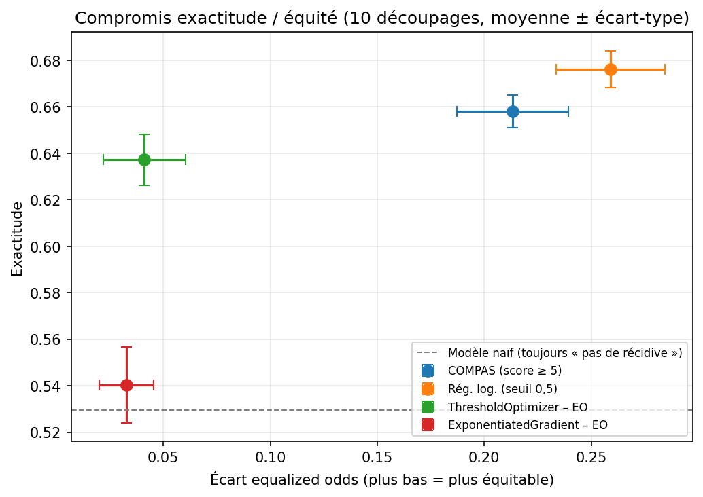

# Measuring and Mitigating Bias in a Recidivism Prediction Model (COMPAS)

[🇫🇷 Français](README.md) | 🇬🇧 English

A fairness audit of the **COMPAS** recidivism risk score and of a prediction model trained on the same data, followed by two bias mitigation methods tested with **Fairlearn**. The project reproduces the main finding of ProPublica's "Machine Bias" investigation (2016), numerically verifies the impossibility theorem of fairness, and discusses the trade-offs between performance and fairness.

**Notebook:** [`compas_fairness_audit.ipynb`](compas_fairness_audit.ipynb) (written in French)

---

## Research questions

1. Does the COMPAS score make the same errors for African-American and Caucasian defendants?
2. Is a model that never sees race any fairer?
3. Can the disparities be corrected, and at what cost?
4. Why did ProPublica and Northpointe (the company behind COMPAS) reach opposite conclusions from the same data?

## Data

- **Source:** [ProPublica, compas-analysis](https://github.com/propublica/compas-analysis), file `compas-scores-two-years.csv` (7,214 defendants, Broward County, Florida, 2013-2014).
- **Filters:** ProPublica's own (screening within ±30 days of arrest, known outcome, traffic offences excluded), leaving **6,172 defendants**.
- **Target:** `two_year_recid`, a new arrest within two years.
- **Groups compared:** African-American (3,175) and Caucasian (2,103); other groups are too small for reliable statistics.

## Method

| Step | Content |
|---|---|
| 1. Exploration | Data composition, recidivism rate by group, score distributions |
| 2. COMPAS audit | "High risk" threshold = score ≥ 5; FPR, FNR, precision, calibration by group |
| 3. Models | Logistic regression and gradient boosting on 7 features (age, sex, prior counts, juvenile counts, charge degree); **race excluded** |
| 4. Fairness assessment | Fairlearn `MetricFrame`, demographic parity, equalized odds |
| 5. Mitigation | `ThresholdOptimizer` (post-processing) and `ExponentiatedGradient` (in-processing), equalized odds constraint |
| 5 bis. Robustness | The whole experiment repeated over 10 random train/test splits |
| 6. Discussion | Impossibility theorem, value choices, limitations |

## Key results

### 1. ProPublica's finding is reproduced

| COMPAS score (threshold ≥ 5) | African-American | Caucasian |
|---|---|---|
| False positive rate (non-reoffenders labelled "high risk") | **42.3%** | 22.0% |
| False negative rate (reoffenders labelled "low risk") | 28.5% | **49.6%** |
| Accuracy | 64.9% | 67.2% |

Accuracy is almost identical, but **the errors do not fall on the same people**.

### 2. The impossibility theorem, verified on the data

Following Chouldechova (2017), FPR = p/(1−p) × (1−precision)/precision × (1−FNR), where *p* is the group's recidivism rate. Using only the base rates (52.3% and 39.1%), precisions and FNRs, the formula recovers COMPAS's false positive rates **exactly** (0.423 and 0.220). Whenever base rates differ, a calibrated score cannot have equal error rates: **ProPublica and Northpointe were both right**, each under their own definition of fairness.

### 3. Results over 10 splits (mean ± standard deviation)

| Model | Accuracy | Equalized odds gap | Precision gap |
|---|---|---|---|
| COMPAS (score ≥ 5) | 0.658 ± 0.007 | 0.213 ± 0.026 | 0.054 ± 0.028 |
| Logistic regression | 0.676 ± 0.008 | 0.259 ± 0.025 | 0.084 ± 0.032 |
| ThresholdOptimizer – EO | 0.637 ± 0.011 | **0.041 ± 0.019** | 0.138 ± 0.034 |
| ExponentiatedGradient – EO | 0.540 ± 0.016 | 0.033 ± 0.013 | 0.154 ± 0.045 |

*Baseline: a model that always predicts "no recidivism" scores 0.529.*



## Takeaways

- **A simple model matches COMPAS.** With 7 features, logistic regression reaches an AUC of 0.727 ± 0.008 versus 0.713 ± 0.010 for COMPAS (better in 7 of 10 splits), in line with Dressel and Farid (2018).
- **Ignoring race is not enough.** Without ever seeing race, the model is no fairer than COMPAS: the information flows through correlated features, mainly the number of prior offences.
- **Mitigation works, at a cost.** `ThresholdOptimizer` cuts the equalized odds gap by about 6× for 3.9 accuracy points. But equality is partly reached by raising one group's false positives, it requires race at decision time, and it relies on randomised decisions near the threshold.
- **Equalising errors breaks calibration**: the precision gap rises from 0.084 to 0.138.
- **A fairness metric must never be read alone.** `ExponentiatedGradient` looks very fair, but only because it barely predicts anything (0.540 versus 0.529 for the naive baseline).
- **Choosing a fairness metric is a value judgement**, a matter for law and public debate as much as for engineering.

## Limitations

- **The target is not the crime**: it measures a new *arrest*. If a group is policed more heavily, its measured recidivism rate is inflated.
- **The dataset construction is disputed**: Barenstein (2019) argues the filtering kept too many reoffenders.
- **Narrow scope**: one county, two years, two groups; race is treated as an administrative category.
- **ExponentiatedGradient was not tuned**; its results do not judge the method in general.
- **Group fairness only**: individual fairness (treating similar people similarly) is not studied.
- The robustness test led me to **correct an initial conclusion**: the near-equal precision observed on a first split did not hold up.

## Reproducing the results

Python 3.13, Kaggle environment. Data is downloaded directly from ProPublica's repository (Internet access required).

```bash
pip install -r requirements.txt
jupyter notebook compas_fairness_audit.ipynb
```

## References

- Angwin, J., Larson, J., Mattu, S., Kirchner, L. (2016). [Machine Bias](https://www.propublica.org/article/machine-bias-risk-assessments-in-criminal-sentencing). *ProPublica*. Methodology: [How We Analyzed the COMPAS Recidivism Algorithm](https://www.propublica.org/article/how-we-analyzed-the-compas-recidivism-algorithm).
- Kleinberg, J., Mullainathan, S., Raghavan, M. (2017). [Inherent Trade-Offs in the Fair Determination of Risk Scores](https://arxiv.org/abs/1609.05807). *ITCS 2017*.
- Chouldechova, A. (2017). [Fair Prediction with Disparate Impact: A Study of Bias in Recidivism Prediction Instruments](https://arxiv.org/abs/1703.00056). *Big Data*, 5(2), 153-163.
- Dressel, J., Farid, H. (2018). [The accuracy, fairness, and limits of predicting recidivism](https://doi.org/10.1126/sciadv.aao5580). *Science Advances*, 4(1).
- Barenstein, M. (2019). [ProPublica's COMPAS Data Revisited](https://arxiv.org/abs/1906.04711). *arXiv:1906.04711*.
- [Fairlearn](https://fairlearn.org/), version 0.15.0.

## Author

**Mohamed Abderrahman Gaouar**, first-year Master's student in Artificial Intelligence, Abou Bekr Belkaid University of Tlemcen (Algeria).
