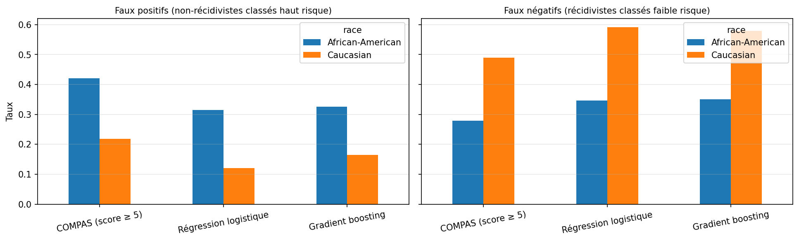
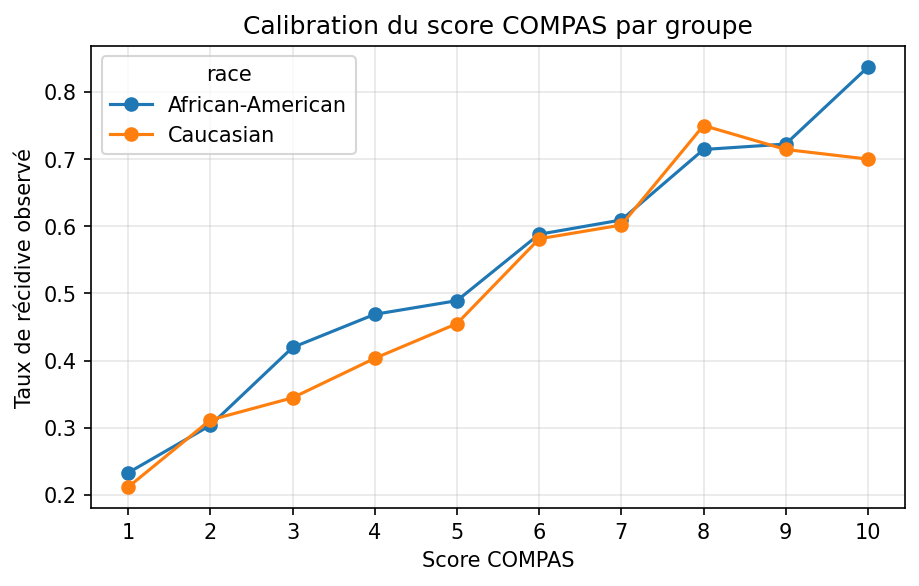
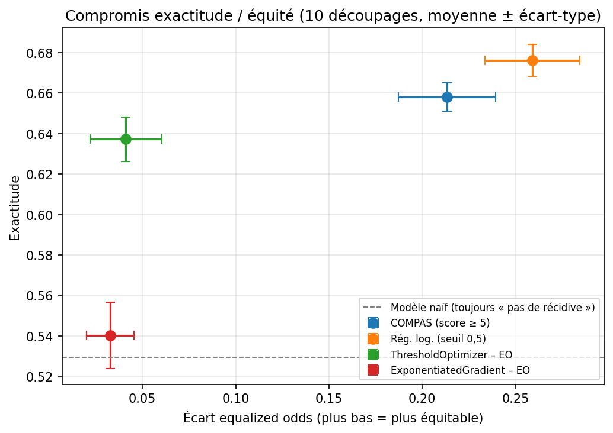

# Mesurer et corriger les biais d'un modèle de prédiction de récidive (COMPAS)

🇫🇷 Français | [🇬🇧 English](README.en.md)

Audit d'équité du score de récidive **COMPAS** et d'un modèle de prédiction entraîné sur les mêmes données, puis test de deux méthodes de correction avec **Fairlearn**. Le projet reproduit le constat de l'enquête « Machine Bias » de ProPublica (2016), vérifie numériquement le théorème d'impossibilité de l'équité, et discute les compromis entre performance et équité.

**Notebook :** [`compas_fairness_audit.ipynb`](compas_fairness_audit.ipynb)

---

## Contexte

Aux États-Unis, certains tribunaux utilisent un logiciel appelé **COMPAS** pour aider les juges à décider, par exemple, si une personne arrêtée peut rester en liberté en attendant son procès. COMPAS attribue à chaque prévenu une note de 1 à 10 qui **estime son risque d'être de nouveau arrêté** dans les deux ans.

En 2016, les journalistes de **ProPublica** ont comparé ces notes à ce qui s'était réellement passé pour environ 7 000 prévenus de Floride. Leur constat : le logiciel ne se trompe pas de la même façon selon les groupes. Parmi les personnes qui n'ont **pas** été réarrêtées, les prévenus afro-américains avaient été classés « à haut risque » presque **deux fois plus souvent** que les prévenus caucasiens. L'éditeur du logiciel, Northpointe, a répondu que sa note était pourtant fiable de la même manière pour tous les groupes.

Ce projet reprend ce débat avec les données publiques : il vérifie les deux arguments, montre pourquoi ils peuvent être vrais en même temps, et teste s'il est possible de corriger ces écarts, et à quel prix. Derrière ce cas, une question plus générale : **un modèle n'est jamais plus juste que les données qui l'ont nourri**, et une décision automatisée qui paraît objective peut reproduire une injustice.

## Questions étudiées

1. Le score COMPAS commet-il les mêmes erreurs pour les prévenus afro-américains et caucasiens ?
2. Un modèle qui n'a jamais accès à la race est-il plus équitable ?
3. Peut-on corriger les écarts, et à quel prix ?
4. Pourquoi ProPublica et Northpointe (l'éditeur de COMPAS) arrivaient-ils à des conclusions opposées sur les mêmes données ?

## Données

- **Source :** [ProPublica, compas-analysis](https://github.com/propublica/compas-analysis), fichier `compas-scores-two-years.csv` (7 214 prévenus, comté de Broward, Floride, 2013-2014).
- **Filtres :** ceux de ProPublica (évaluation à ±30 jours de l'arrestation, issue connue, infractions routières exclues), soit **6 172 prévenus**.
- **Cible :** `two_year_recid`, nouvelle arrestation dans les deux ans.
- **Groupes comparés :** Afro-Américains (3 175) et Caucasiens (2 103) ; les autres groupes sont trop petits pour des statistiques fiables.

## Méthode

| Étape | Contenu |
|---|---|
| 1. Exploration | Composition des données, taux de récidive par groupe, distribution des scores |
| 2. Audit de COMPAS | Seuil « haut risque » = score ≥ 5 ; FPR, FNR, précision, calibration par groupe |
| 3. Modèles | Régression logistique et gradient boosting sur 7 variables (âge, sexe, antécédents, antécédents juvéniles, gravité de l'accusation) ; **race exclue** |
| 4. Mesure d'équité | `MetricFrame` de Fairlearn, parité démographique, *equalized odds* |
| 5. Correction | `ThresholdOptimizer` (post-traitement) et `ExponentiatedGradient` (pendant l'entraînement), contrainte *equalized odds* |
| 5 bis. Robustesse | Toute l'expérience répétée sur 10 découpages train/test aléatoires |
| 6. Discussion | Théorème d'impossibilité, choix de valeurs, limites |

## Résultats principaux

### 1. Le constat de ProPublica est reproduit

| Score COMPAS (seuil ≥ 5) | Afro-Américains | Caucasiens |
|---|---|---|
| Taux de faux positifs (non-récidivistes classés « haut risque ») | **42,3 %** | 22,0 % |
| Taux de faux négatifs (récidivistes classés « faible risque ») | 28,5 % | **49,6 %** |
| Exactitude | 64,9 % | 67,2 % |

L'exactitude est presque identique, mais **les erreurs ne tombent pas sur les mêmes personnes**. Le même déséquilibre se retrouve dans nos propres modèles, qui n'ont pourtant jamais vu la race :


*Taux d'erreur par groupe sur le jeu de test, pour COMPAS et nos deux modèles (l'argument de ProPublica).*

### 2. Le théorème d'impossibilité, vérifié sur les données

Pourtant, à score égal, les taux de récidive observés sont proches dans les deux groupes : le score est globalement **calibré**.


*Taux de récidive observé pour chaque score COMPAS, par groupe (l'argument de Northpointe).*

Selon Chouldechova (2017), FPR = p/(1−p) × (1−précision)/précision × (1−FNR), où *p* est le taux de récidive du groupe. À partir des seuls taux de base (52,3 % et 39,1 %), précisions et FNR, la formule retrouve **exactement** les FPR de COMPAS (0,423 et 0,220). Dès que les taux de base diffèrent, un score calibré ne peut pas avoir des taux d'erreur égaux : **ProPublica et Northpointe avaient tous deux raison**, chacun selon sa définition de l'équité.

### 3. Résultats sur 10 découpages (moyenne ± écart-type)

| Modèle | Exactitude | Écart *equalized odds* | Écart de précision |
|---|---|---|---|
| COMPAS (score ≥ 5) | 0,658 ± 0,007 | 0,213 ± 0,026 | 0,054 ± 0,028 |
| Régression logistique | 0,676 ± 0,008 | 0,259 ± 0,025 | 0,084 ± 0,032 |
| ThresholdOptimizer – EO | 0,637 ± 0,011 | **0,041 ± 0,019** | 0,138 ± 0,034 |
| ExponentiatedGradient – EO | 0,540 ± 0,016 | 0,033 ± 0,013 | 0,154 ± 0,045 |

*Référence : un modèle qui prédit toujours « pas de récidive » obtient 0,529.*



## Ce que j'en retiens

- **Un modèle simple égale COMPAS.** Avec 7 variables, la régression logistique obtient une AUC de 0,727 ± 0,008 contre 0,713 ± 0,010 pour COMPAS (meilleure dans 7 découpages sur 10), en accord avec Dressel et Farid (2018).
- **Ignorer la race ne suffit pas.** Sans jamais voir la race, le modèle n'est pas plus équitable que COMPAS : l'information passe par des variables corrélées, surtout le nombre d'antécédents.
- **La correction fonctionne, à un prix.** `ThresholdOptimizer` divise l'écart *equalized odds* par environ 6 pour 3,9 points d'exactitude. Mais l'égalité est atteinte en partie en augmentant les faux positifs d'un groupe, elle exige la race au moment de la décision, et elle recourt à des décisions aléatoires près du seuil.
- **Égaliser les erreurs détruit la calibration** : l'écart de précision passe de 0,084 à 0,138.
- **Une métrique d'équité ne se lit jamais seule.** `ExponentiatedGradient` paraît très équitable, mais seulement parce qu'il ne prédit presque plus rien (0,540 contre 0,529 pour le modèle naïf).
- **Choisir une métrique est un choix de valeurs**, qui relève du droit et du débat public autant que de la technique.
- **Un compromis qu'on retrouve dans l'explicabilité.** Le théorème d'impossibilité montre qu'un modèle ne peut pas satisfaire tous les critères d'équité à la fois. On retrouve une idée proche dans les travaux de Leila Amgoud, Philippe Muller et Henri Trenquier (IJCAI 2023) : une explication construite à partir d'un échantillon ne peut pas être à la fois garantie pour chaque décision et toujours correcte. Équité comme explication, une IA de confiance oblige à choisir entre des propriétés souhaitables.

## Limites

- **La cible n'est pas le délit** : elle mesure une nouvelle *arrestation*. Si un groupe est davantage contrôlé, son taux de récidive mesuré est surestimé.
- **La construction du jeu de données est contestée** : Barenstein (2019) estime que le filtrage a conservé trop de récidivistes.
- **Portée restreinte** : un seul comté, deux années, deux groupes ; la race est traitée comme une catégorie administrative.
- **ExponentiatedGradient n'a pas été réglé** ; ses résultats ne jugent pas la méthode en général.
- **Équité de groupe uniquement** : l'équité individuelle (traiter pareil deux personnes identiques) n'est pas étudiée.
- Le test de robustesse a conduit à **corriger une conclusion initiale** : la quasi-égalité des précisions observée sur un premier découpage n'était pas robuste.

## Reproduire les résultats

Python 3.13, environnement Kaggle. Les données sont téléchargées directement depuis le dépôt de ProPublica (accès Internet nécessaire).

```bash
pip install -r requirements.txt
jupyter notebook compas_fairness_audit.ipynb
```

## Structure du dépôt

```
compas-fairness-audit/
├── compas_fairness_audit.ipynb   # analyse complète
├── figures/                      # graphiques utilisés dans le README
├── requirements.txt
├── README.md                     # français
├── README.en.md                  # anglais
└── LICENSE
```

## Références

- Angwin, J., Larson, J., Mattu, S., Kirchner, L. (2016). [Machine Bias](https://www.propublica.org/article/machine-bias-risk-assessments-in-criminal-sentencing). *ProPublica*. Méthodologie : [How We Analyzed the COMPAS Recidivism Algorithm](https://www.propublica.org/article/how-we-analyzed-the-compas-recidivism-algorithm).
- Kleinberg, J., Mullainathan, S., Raghavan, M. (2017). [Inherent Trade-Offs in the Fair Determination of Risk Scores](https://arxiv.org/abs/1609.05807). *ITCS 2017*.
- Chouldechova, A. (2017). [Fair Prediction with Disparate Impact: A Study of Bias in Recidivism Prediction Instruments](https://arxiv.org/abs/1703.00056). *Big Data*, 5(2), 153-163.
- Dressel, J., Farid, H. (2018). [The accuracy, fairness, and limits of predicting recidivism](https://doi.org/10.1126/sciadv.aao5580). *Science Advances*, 4(1).
- Barenstein, M. (2019). [ProPublica's COMPAS Data Revisited](https://arxiv.org/abs/1906.04711). *arXiv:1906.04711*.
- Amgoud, L., Muller, P., Trenquier, H. (2023). Leveraging Argumentation for Generating Robust Sample-based Explanations. *Proceedings of IJCAI 2023*, 3104-3111.
- [Fairlearn](https://fairlearn.org/), version 0.15.0.

## Auteur

**Mohamed Abderrahman Gaouar**, étudiant en Master 1 Intelligence artificielle, Université Abou Bekr Belkaid de Tlemcen (Algérie).
